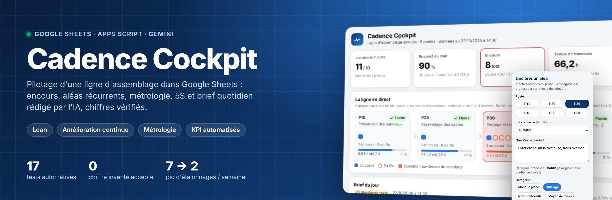
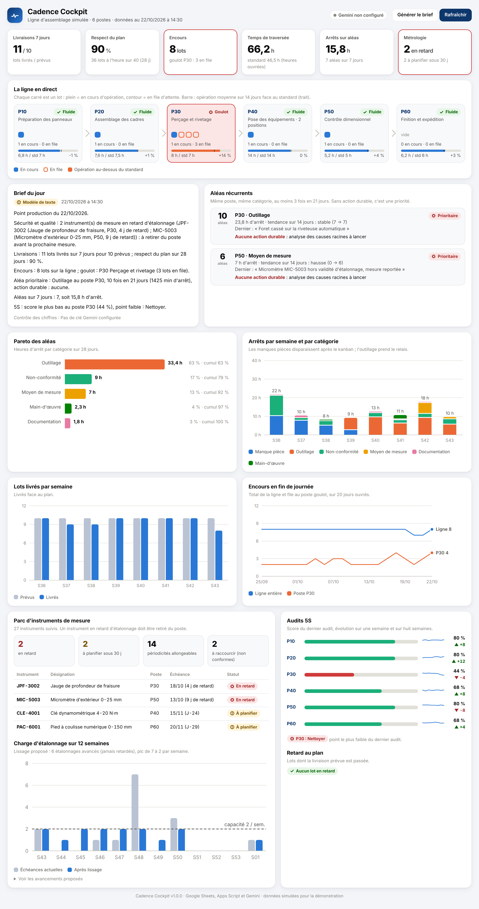
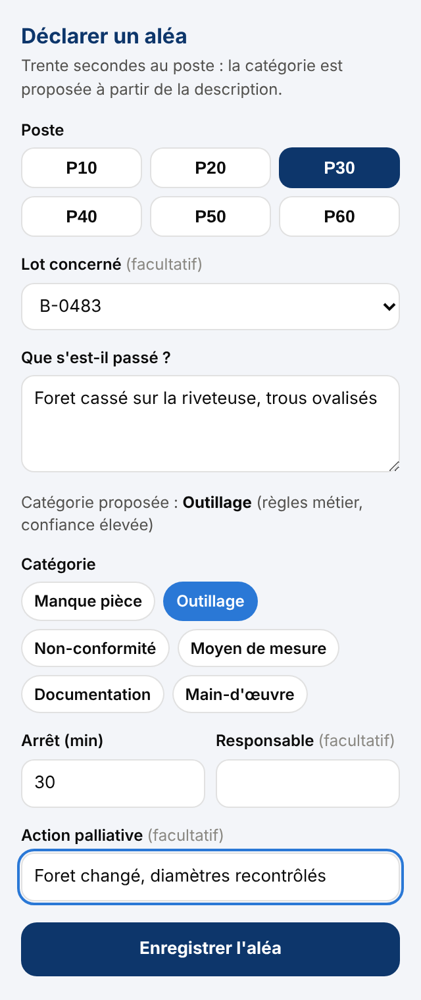
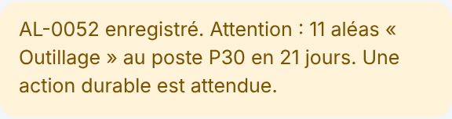
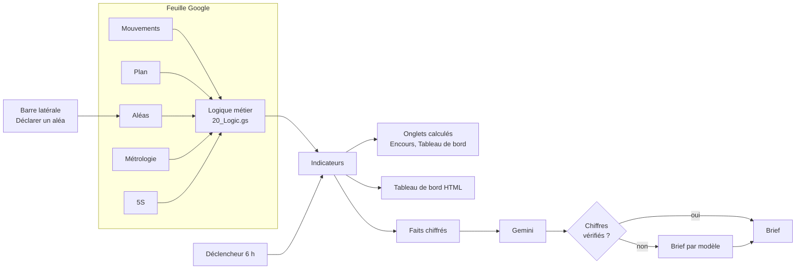

<p align="center"></p>

<p align="center">
  <a href="https://github.com/Abderrahmane-BOULAMI/cadence-cockpit/actions/workflows/tests.yml"></a>
  
  
  
</p>

**Cadence Cockpit transforme un simple Google Sheets en poste de pilotage d'une ligne d'assemblage** : suivi des encours poste par poste, détection des aléas récurrents, gestion du parc d'instruments de mesure, audits 5S et brief quotidien rédigé par Gemini, dont chaque chiffre est vérifié avant d'être affiché.

Tout tient dans les outils que l'équipe utilise déjà : une feuille Google, un menu, une barre latérale pour déclarer un aléa en trente secondes, un tableau de bord qui se met à jour seul chaque matin.

<p align="center"></p>

## Ce que le cockpit trouve tout seul

Le dépôt contient huit semaines de données simulées d'une ligne de six postes, avec trois situations volontairement cachées dedans. Le cockpit les retrouve sans qu'on lui dise où chercher, et les tests le vérifient.

| Situation cachée | Ce que montre le cockpit |
|---|---|
| Usure d'outillage de perçage au poste P30, de plus en plus fréquente depuis trois semaines | P30 signalé comme **goulot** (3 lots en file), **10 aléas Outillage en 21 jours**, 23,8 h d'arrêt, **aucune action durable** : alerte prioritaire. Le score 5S de P30 chute à 44 %, point faible « Nettoyer ». |
| Manques pièces au poste P20 il y a un à deux mois, traités par un kanban fournisseur | Les manques disparaissent du graphique par semaine après la mise en place ; P20 n'est plus en récurrence. L'action durable a fonctionné, et cela se voit. |
| Un micromètre du contrôle dimensionnel (P50) passé hors validité d'étalonnage | **MIC-5003 en retard de 9 jours**, à retirer du poste ; 6 aléas « Moyen de mesure » au P50 reliés à lui. |

## Les quatre volets

**1. Gestion de production.** Encours en file et en cours pour chaque poste, temps d'opération face au standard, temps de traversée, respect du plan, lots en retard. La ligne est dessinée en direct : un carré par lot.

**2. Amélioration continue.** Pareto des aléas, arrêts par semaine et par catégorie, détection des récurrences (même poste, même catégorie, au moins 3 fois en 21 jours). Une récurrence sans action durable remonte en tête : c'est là qu'il faut lancer une analyse des causes racines.

**3. Métrologie.** Échéance et statut de chaque instrument (valide, à planifier sous 30 jours, en retard), proposition de périodicité à partir de l'historique des résultats (allonger après 3 étalonnages conformes, raccourcir après une non-conformité, avec plancher et plafond), et **lissage de la charge d'étalonnage** : on avance certains étalonnages, sans jamais en retarder un, pour que le pic passe de **7 à 2 par semaine**.

**4. Brief du jour avec Gemini.** Chaque matin, Gemini rédige le point de production à partir des seuls chiffres calculés par le cockpit. Puis le texte est contrôlé : **tout nombre absent des données fait rejeter le texte**, et le cockpit affiche à la place un brief rédigé par modèle. Sans clé Gemini, tout fonctionne quand même.

<table>
<tr>
<td width="34%"></td>
<td>

### Déclarer un aléa en trente secondes

La barre latérale est pensée pour le terrain : on touche le poste, on décrit ce qui s'est passé, et la **catégorie est proposée automatiquement** (Gemini si la clé est configurée, sinon des règles métier). Le lot en cours au poste est déjà sélectionné.

À l'enregistrement, si l'aléa prolonge une récurrence, l'opérateur et son chef d'équipe le voient tout de suite :



Les saisies sont validées côté serveur (poste, catégorie, durée), protégées contre l'injection de formules, et l'identifiant est attribué sous verrou pour éviter les doublons quand deux personnes déclarent en même temps.

</td>
</tr>
</table>

## Comment c'est construit



| Fichier | Rôle |
|---|---|
| `src/00_Config.gs` | Tous les seuils au même endroit : postes, takt, fenêtre de récurrence, règles de métrologie, modèle Gemini |
| `src/20_Logic.gs` | Logique pure, sans service Google : encours, flux, Pareto, récurrences, métrologie, lissage, 5S, contrôle des chiffres |
| `src/30_Demo.gs` | Simulation à événements discrets de la ligne (capacités, files, aléas) pour la démonstration |
| `src/40_Sheets.gs` | Lecture et écriture des onglets en un seul appel par tableau, listes déroulantes, mises en forme conditionnelles, graphiques |
| `src/50_Gemini.gs` | Appel de l'API Gemini, nouvel essai sur erreur, contrôle des chiffres, repli sans IA |
| `src/60_App.gs` | Menu, tableau de bord, barre latérale, application web, déclencheur quotidien |
| `src/Dashboard.html`, `src/AleaForm.html` | Interfaces HTML, mode clair et sombre, graphiques SVG sans bibliothèque |
| `tests/` | 17 tests Node : le vrai code Apps Script tourne sur une feuille simulée |

Quelques choix qui comptent :

* **La logique est séparée des services Google.** Elle se teste en deux secondes sur n'importe quel ordinateur, et la même fonction calcule l'onglet, le tableau de bord HTML et le brief.
* **La clé Gemini n'est jamais dans la feuille.** Elle est saisie par le menu et stockée dans les propriétés du script ; elle passe dans un en-tête HTTP, pas dans l'URL (vérifié par un test).
* **L'IA ne décide de rien seule.** Elle rédige et propose une catégorie ; une catégorie hors liste ou un chiffre inventé sont refusés.
* **Les colonnes sont lues par leur nom**, pas par leur position : on peut réorganiser un onglet, et une colonne renommée donne un message clair.

## Installer en cinq minutes

1. Créer un Google Sheets vide, puis **Extensions > Apps Script**.
2. Copier chaque fichier du dossier `src/` dans l'éditeur (même nom ; les `.html` en fichiers HTML) et remplacer `appsscript.json` (afficher le fichier manifeste dans les paramètres du projet).
   Ou, avec [clasp](https://github.com/google/clasp) : copier `.clasp.json.example` en `.clasp.json`, y mettre l'identifiant du script, puis `npm run push`.
3. Recharger la feuille : le menu **Cockpit** apparaît. Lancer **Initialiser la démonstration** et accepter les autorisations.
4. Facultatif : **Cockpit > Configurer Gemini** avec une clé de Google AI Studio, puis **Générer le brief du jour**.
5. Facultatif : **Activer la mise à jour quotidienne** pour un rafraîchissement et un brief chaque jour vers 6 h.

Pour l'utiliser sur de vraies données, remplir les onglets Mouvements, Plan, Aléas, Métrologie et 5S (mêmes en-têtes), vider la date de référence dans Paramètres, puis **Rafraîchir les indicateurs**.

## Lancer les tests et l'aperçu

```bash
npm test                 # 17 tests : logique, Gemini simulé, bout en bout sur une feuille simulée
npm run preview          # build/preview_dashboard.html : le tableau de bord avec les données de démonstration
```

## Limites

* **Les données sont simulées.** La ligne, les lots, les aléas et les instruments sont générés ; aucune donnée d'entreprise n'est utilisée. Les situations détectées ont été injectées pour la démonstration.
* **Les captures du tableau de bord viennent de l'aperçu local** (même HTML, mêmes calculs, sur une feuille simulée), pas d'une feuille Google en ligne.
* Le brief Gemini a été testé avec des réponses simulées de l'API ; la qualité réelle du texte dépend du modèle et doit être relue.
* Les règles de périodicité sont volontairement simples (3 conformes pour allonger, une non-conformité pour raccourcir) ; une vraie démarche d'optimisation des intervalles d'étalonnage se valide avec le service qualité.
* Apps Script a ses quotas (6 minutes par exécution, appels externes limités) : adapté à une ligne et quelques milliers de mouvements, pas à un historique d'usine complet.

## Licence

MIT
